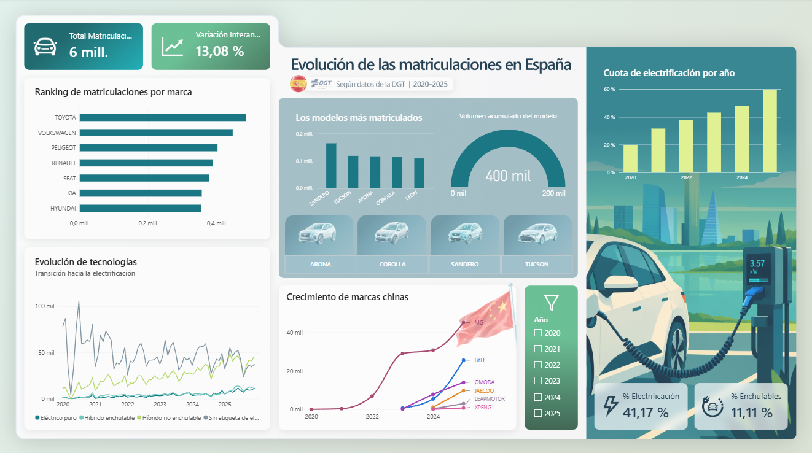

# Matriculaciones de turismos en España (2020-2025)

Pipeline en Python + dashboard en Power BI que convierte los **microdatos mensuales de matriculaciones de la DGT** (72 ficheros de ancho fijo, varios millones de vehículos) en una tabla limpia para analizar:

- ranking de marcas y modelos más matriculados,
- evolución mensual del mercado,
- transición hacia la electrificación (híbridos, enchufables, eléctricos),
- crecimiento de las marcas chinas.



## El reto de los datos

Los TXT de la DGT son registros de **714 caracteres** sin separadores y con texto sucio: la misma marca aparece como `VW`, `VOLKSWAGEN VW` o `VOLKSWAGEN AG`; el modelo viene cortado a 22 caracteres (`C3 AIRCR`), con el acabado pegado (`N 2008 ALLURE PURETECH`) o con la marca repetida (`CITROEN CITROEN C3`). Sin limpiar, un mismo modelo se reparte en cientos de etiquetas y los rankings salen mal.

## Qué hace el código

1. **Lee** los TXT línea a línea (posiciones verificadas contra el [diseño de registro oficial](https://www.dgt.es/export/sites/web-DGT/.galleries/downloads/dgt-en-cifras/matraba/MATRICULACIONES_MATRABA.pdf): 69 campos, 714 caracteres).
2. **Filtra turismos nuevos de matriculación ordinaria** (ver definición más abajo).
3. **Normaliza** marcas y modelos con catálogos editables (`catalogos/*.csv`) y reglas por serie (BMW 120d → `SERIE 1`, Mercedes A 200 → `CLASE A`).
4. **Rescata** modelos no reconocidos usando el `CODIGO_ITV` (código de homologación) de vehículos ya clasificados.
5. **Agrega** por mes, marca, modelo y tecnología y **escribe auditorías** de todo lo que descarta o no puede clasificar.

## Definición de "turismo"

Un registro entra si cumple **todo** lo siguiente:

| Condición | Campo | Valor |
|---|---|---|
| Categoría de homologación | `CATEGORIA_HOMOLOGACION_UE` | `M1` |
| Vehículo nuevo | `IND_NUEVO_USADO` | `N` |
| Matriculación ordinaria | `CLAVE_TRAMITE` | `1` |
| No es carrocería especial (autocaravana, ambulancia, blindado...) | `CARROCERIA` | no empieza por `S` |
| Servicio de turismo | `SERVICIO` | no es ambulancia, funerario, policía, bomberos, vivienda... |
| Modelo | catálogo | no es una furgoneta grande (Transit, Sprinter, Crafter, Master, Trafic...) |

Los monovolúmenes y vehículos de pasajeros derivados de furgoneta (Proace City Verso, Berlingo, Zafira Life, Clase V) **se mantienen**: son M1.
Taxis y coches de alquiler **se mantienen**: son turismos que se matriculan como cualquier otro.

Todo lo excluido queda en `data/processed/registros_excluidos.csv` con su motivo, para que la decisión sea auditable.

## Estructura

```
├── procesar_matriculaciones.py   # lectura de TXT, filtros, agregación, informes
├── normalizacion.py              # limpieza de marcas y modelos
├── catalogos/
│   ├── marcas.csv                # alias, marcas a excluir, transformadores
│   ├── modelos.csv               # marca, patrón, modelo normalizado, incluir (1/0)
│   └── cambios_marca.csv         # CUPRA registrado bajo SEAT, ABARTH bajo FIAT...
├── tests/                        # pruebas con ficheros sintéticos
├── data/
│   ├── raw/                      # aquí van los TXT descargados (no se versionan)
│   └── processed/                # resultados
└── docs/
```

## Cómo reproducirlo

```bash
pip install -r requirements.txt

# 1. Descarga los 72 ficheros mensuales (2020-2025) de la DGT y colócalos en data/raw/
#    https://www.dgt.es/menusecundario/dgt-en-cifras/dgt-en-cifras-resultados/dgt-en-cifras-detalle/Microdatos-de-Matriculaciones-de-Vehiculos-mensual/
#    Nombres esperados: export_mensual_mat_202001.txt ... export_mensual_mat_202512.txt

# 2. (Recomendado) Mira qué valores de carrocería, servicio, etc. hay de verdad
python procesar_matriculaciones.py --perfilar

# 3. Proceso completo
python procesar_matriculaciones.py

# Pruebas
python -m unittest discover -s tests -v
```

### Resultados (`data/processed/`)

| Archivo | Contenido |
|---|---|
| `matriculaciones_turismos.csv` | **Tabla para Power BI**: periodo, año, mes, marca, modelo, tecnología, matriculaciones |
| `modelos_pendientes_revision.csv` | Modelos que el catálogo no reconoce, ordenados por volumen: **la lista de tareas para mejorar la limpieza** |
| `auditoria_modelos.csv` | Cada modelo original, a qué se normalizó y con qué método |
| `auditoria_marcas.csv` | Cada marca original y su normalización |
| `registros_excluidos.csv` | Qué se descartó y por qué |
| `resumen_procesamiento.csv` | Contadores por fichero (líneas leídas, descartadas por cada motivo) |

## Cómo mejorar la clasificación

No hace falta tocar el código. Abre `modelos_pendientes_revision.csv`, mira los modelos con más matriculaciones y añade una fila en `catalogos/modelos.csv`:

```
marca,patron,modelo,incluir
RENAULT,KADJAR,KADJAR,1
```

El patrón coincide si el modelo **empieza** por él (`C3` coincide con `C3 PURETECH` pero no con `C30`). Con `*` delante el texto solo debe **contener** la palabra (`*BERLINGO`). Vuelve a ejecutar y comprueba el porcentaje de modelos clasificados que se imprime al final.

## Limitaciones

- **Nivel de detalle: familia de modelo.** `A3 Sportback` y `A3` cuentan como `A3`; `C3` y `C3 Aircross` se mantienen separados porque son coches distintos.
- **`MODELO_ITV` tiene 22 caracteres.** Los nombres largos llegan cortados; el catálogo lo tiene en cuenta y el `CODIGO_ITV` rescata parte de los casos.
- **"Híbrido no enchufable" (HEV)** sigue la categoría de vehículo eléctrico registrada por la DGT y probablemente incluye microhíbridos (MHEV). La cuota de electrificación depende de esa definición.
- **"Sin etiqueta de electrificación"** agrupa gasolina, diésel, gas y todo lo que no declara categoría eléctrica.
- **El periodo es el del fichero mensual**, no la fecha exacta de matriculación; el número de registros con fecha distinta se anota en `resumen_procesamiento.csv`.
- Las autocaravanas se filtran por carrocería y servicio, así que la calidad del filtro depende de que esos campos estén bien informados (por eso existe `--perfilar`).

## Licencia

Código bajo licencia MIT. Los datos son de la DGT; consulta sus condiciones de reutilización en su portal de datos abiertos.
